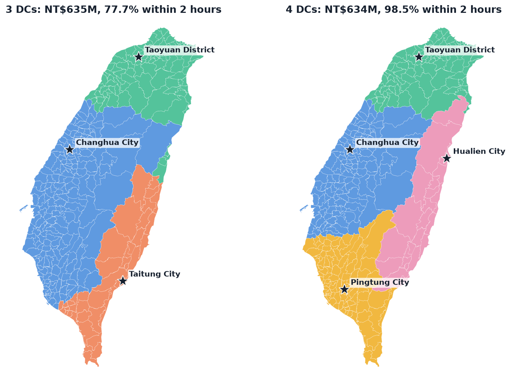
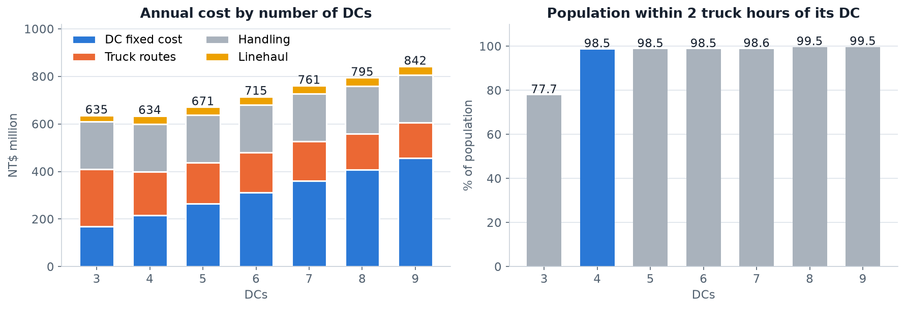
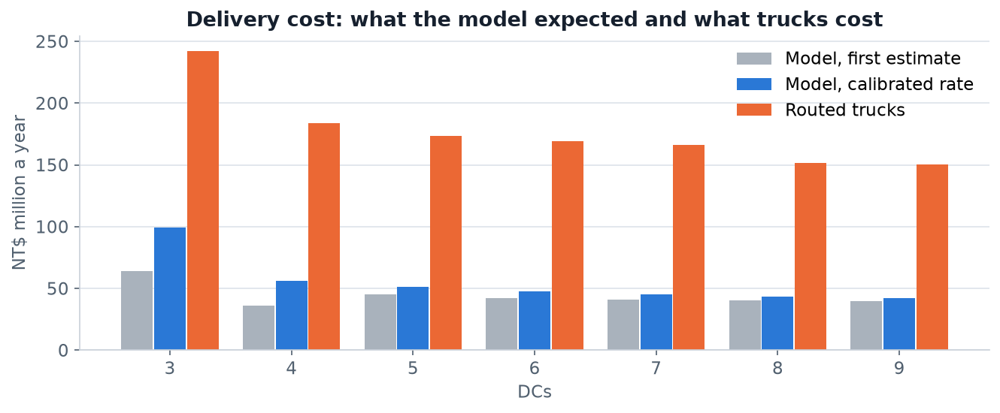
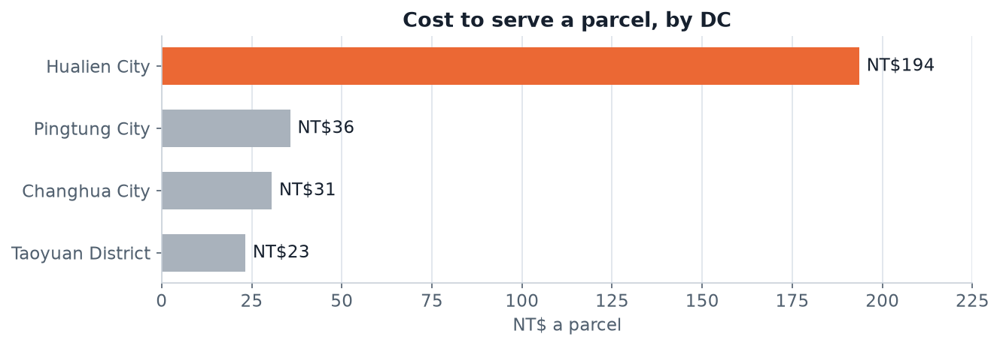

# Where Should a Distribution Centre Go? Network Design and Routing for Taiwan

[](https://github.com/Haven-Pham/taiwan-distribution-network-optimization/actions/workflows/ci.yml)


**[Open the interactive map](https://haven-pham.github.io/taiwan-distribution-network-optimization/)** (English / 繁體中文)

## Overview

A national online retailer has to decide where to put its distribution centres (DCs) and how to route trucks from them. These decisions are usually made separately, which hides a problem: the network model has to price delivery before anyone has seen a route. This project joins the two with OR-Tools, on Taiwan's real geography, and feeds the cost of solved routes back into the network decision.

**What is real and what is assumed.** Population for 349 townships and road distances between them are real. The company, its 20 million parcels a year and all its costs are assumptions, so results are comparisons between options, not a budget.

**Summary of results.** The recommended network has four DCs, at Taoyuan, Changhua, Pingtung and Hualien, for about NT$634M a year. Three and four DCs cost the same, so service decides: four bring 98.5% of the population within two truck hours, against 77.7%. The east coast is the most striking result: 2.2% of parcels drive about 16% of network cost, so a carrier charging under about NT$225 a parcel would beat running it in-house.



## Business Questions

1. How many DCs should there be, and where?
2. How wrong is a simple per-kilometre delivery estimate, and does it change the decision?
3. What does next-morning delivery to the east coast cost?
4. How much does route optimisation save, and how far can the solver be trusted?
5. How fragile is the network if a DC is lost?

## Approach

- **Real roads.** Each township is a delivery station, with road distances and times from OpenStreetMap through OSRM. Road distance between the east coast and the west is typically about double the straight line, so straight-line distance would be wrong here.
- **Network design with CP-SAT.** A capacitated facility location model chooses from 32 candidates, picked by a fixed rule, and assigns each township to one DC. It requires a truck leaving at 03:00 to reach every station by 09:00 and return within 10 hours. Each model is solved to proven optimality.
- **Routing with the OR-Tools routing library.** Each DC's daily routes respect truck capacity, arrival deadlines and shift length. An independent checker confirms that every plan follows the rules.
- **A feedback loop.** Routed cost gives a calibrated delivery rate, the network is solved again, and this repeats until the rate settles. Each network's final cost comes from routing trucks on simulated days, not from the model's estimate.
- **Checks on the solver and the assumptions.** The router is tested on public benchmarks with known best values, the network on the loss of each DC, and the conclusions on eight changes of assumption.

## Key Findings

**Three and four DCs cost the same, so service decides.** Beyond four, each extra DC adds NT$34–47M a year.

| DCs | Annual cost | Cost a parcel | Population within 2 truck hours | Longest trip |
|---:|---:|---:|---:|---:|
| 3 | NT$635M | NT$31.8 | 77.7% | 4.8 h |
| **4** | **NT$634M** | **NT$31.7** | **98.5%** | **4.6 h** |
| 5 | NT$671M | NT$33.5 | 98.5% | 4.6 h |
| 6 | NT$715M | NT$35.8 | 98.5% | 4.6 h |
| 8 | NT$795M | NT$39.7 | 99.5% | 3.0 h |



**Sites just outside the big cities beat the obvious choices.** Under the assumed rents, intuitive networks cost NT$22–48M a year more, or 3.5–7.6%. Each needed a Hualien DC added to meet the promise.

**A rough delivery estimate misjudged the budget far more than the decision.** My first estimate of NT$0.05 a parcel-km gave NT$36M a year of delivery cost at four DCs, while routed trucks cost NT$184M. Calibration raises the rate to about NT$0.08, but much of the gap remains, because about NT$113M a year comes from stopping at stations, whichever DC serves them. The network the first estimate preferred costs only 0.7% more than the best one.



**The east coast is expensive.** The next-morning promise forces a DC east of the mountains, in every network and every sensitivity case. The Hualien DC costs NT$194 a parcel, against NT$23–36 in the west. Handing Hualien and Taitung counties to a carrier lets the network run on two western DCs at about NT$100M a year less, a break-even of about NT$225 a parcel. The trade-off is weaker western service: 91.5% of the western population within two truck hours.



**Routing saves about 15%, and standard methods deliver it.** Against a nearest-neighbour rule, solved routes save about NT$33M a year. All of that comes from the savings construction with local search: guided local search found nothing further within 15 seconds for each DC. On the largest DC, cost falls about 4% between 1 and 30 seconds of search, then stops improving.

**The solver is strong, but routes are not proven best.**

| Benchmark instance | Best known | Found in 30 s | Gap |
|---|---:|---:|---:|
| A-n32-k5 | 784 | 784 | 0.0% |
| B-n31-k5 | 672 | 675 | 0.4% |
| M-n101-k10 | 820 | 831 | 1.3% |
| X-n101-k25 | 27,591 | 29,087 | 5.4% |

**One DC carries too much.** The network keeps enough capacity after losing any single DC, but losing Taoyuan more than doubles transport cost and leaves another DC at 97% of capacity. Losing Pingtung or Hualien breaks the delivery promise for under 1% of people.

**The shape holds under other assumptions, and the exact sites do not.** All eight changed assumptions choose three or four DCs, with one east of the mountains every time. Four keep the recommended network. A parcel costs about NT$47 at 10 million parcels a year and NT$23 at 40 million.

## Recommendations

| Finding | Decision it informs |
|---|---|
| Three and four DCs cost the same, while four give far better service | Choose four: Taoyuan, Changhua, Pingtung, Hualien |
| Intuitive big-city networks cost NT$22–48M more | Look at sites just outside the big cities, subject to real rent quotes |
| A per-kilometre estimate understated the delivery budget up to five times | Check a network model against routed trucks before setting a budget |
| 2.2% of parcels drive about 16% of cost | Get carrier quotes for the east coast, against a break-even of about NT$225 a parcel |
| Good routing saves about 15% against a rule of thumb | Adopt routing software first: standard methods deliver the gain within seconds to a minute |
| Taoyuan carries 48% of the population | Plan a backup for Taoyuan before the other DCs |

## Deliverables

- [Interactive map](https://haven-pham.github.io/taiwan-distribution-network-optimization/): compare networks of three to eight DCs, see one day of truck routes, in English and Traditional Chinese.
- [Analysis notebook](notebooks/taiwan_network_design_routing.ipynb): the full analysis, with its reasoning and limitations.
- [Excel workbook](reports/Taiwan_Network_Optimization_Results.xlsx): a summary sheet and 13 result tables.
- [Figures](reports/figures) and [CSV tables](reports/tables).
- A tested Python package in [src/network_design](src/network_design).

## Repository Structure

```
├── dashboard/            Interactive map, with no external dependencies
├── data/processed/       Township table, outlines and the road matrix snapshot
├── notebooks/            Analysis notebook, with outputs
├── reports/              Excel workbook, figures and tables
├── scripts/              Geography, experiments, notebook, workbook and dashboard builds
├── src/network_design/   Geography, scenario, network, routing, evaluation and parallel modules
├── tests/                Unit tests, including proofs by enumeration and benchmark instances
└── .github/workflows/    Tests, map deployment and a full reproduction on request
```

## Reproducing

```bash
pip install -r requirements.txt
python -m pytest -q
python scripts/run_notebook.py          # reads the committed results, about a minute
python scripts/build_excel_report.py
python scripts/build_dashboard.py

python scripts/run_experiments.py       # reruns every optimisation, about 40 minutes on 8 cores
```

A stopped run continues from its last finished stage. Network models are solved to proven optimality, but the routing search stops on a time limit, so route costs depend on the machine and a rerun may differ slightly.

## Data

Population and boundaries come from the Ministry of the Interior through [data.gov.tw](https://data.gov.tw) (Open Government Data License 1.0). Road data are © OpenStreetMap contributors, used through the public [OSRM](https://project-osrm.org) server and shared under the [ODbL](https://opendatacommons.org/licenses/odbl/). See [data/README.md](data/README.md) for each source and how a township becomes a point.

## Limitations

- **The company is fictional.** Volumes, rents, fleet costs and the service promise are assumptions, not quotes. Comparisons are more reliable than amounts.
- **Demand follows population.** Real demand also follows income, age and urban density.
- **One point per township.** Delivery beyond the station is not modelled, and two mountain township points remain far from a road.
- **Road data.** Times are car times scaled by an assumed factor of 1.25, with no traffic, weather or closures, which matter on the Suhua Highway and mountain roads.
- **Fixed candidates.** The 32 candidates follow a rule and do not reflect available land or zoning, so a better site may exist outside the list.
- **Routes are good, not proven best.** Costs come from heuristic solutions on five simulated days, so differences under about 1% should not be read as real.
- **One period.** DC capacity is a fixed limit, with no seasonal peaks or growth over time.
- **Offshore islands are excluded,** with 1.2% of the population.

## 繁體中文摘要

本專案以 OR-Tools 結合臺灣真實人口與道路資料，探討物流中心選址與貨車路線規劃（公司、貨量與成本皆為假設）。建議方案為桃園、彰化、屏東與花蓮 4 個物流中心，年度成本約 6.34 億元。3 個與 4 個物流中心的成本相當，但 4 個可使 98.5% 人口位於 2 小時車程內（3 個為 77.7%）。東部僅占 2.2% 的包裹，卻造成約 16% 的網路成本，因此每件低於約 225 元的委外運費將比自營更划算。歡迎參閱[互動式地圖](https://haven-pham.github.io/taiwan-distribution-network-optimization/?lang=zh)。

## Author

Pham Hong Hieu (Haven) · [Portfolio](https://haven-portfolio02.vercel.app) · [LinkedIn](https://www.linkedin.com/in/havenpham) · [GitHub](https://github.com/Haven-Pham)
